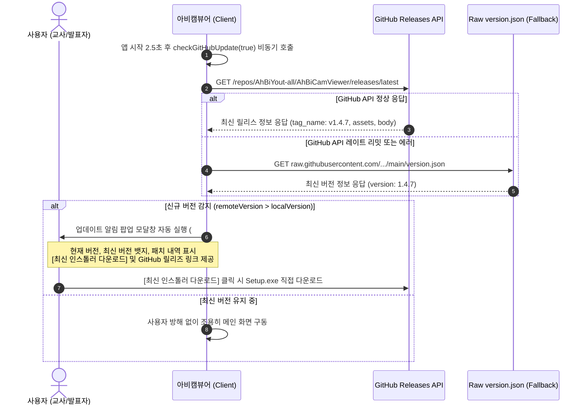

# 🐙 GitHub 운영 및 CI/CD 릴리즈 공식 가이드 (GitHub Guide)

본 문서는 **아비캠뷰어 (AhBiCamViewer)**의 GitHub 저장소 관리 규정, 보안 정책, CI/CD 자동화 파이프라인 및 실시간 릴리즈 배포 시스템을 설명합니다.

---

## 1. 👤 [제작자 및 공식 채널 안내]

- **개발자 (Developer)**: `AhBiYout`
- **GitHub 저장소**: [`https://github.com/AhBiYout-all`](https://github.com/AhBiYout-all)
- **공식 구글 블로그**: [`https://ahbiyoutvibe.blogspot.com/`](https://ahbiyoutvibe.blogspot.com/)
- **앱 저장소**: [`https://github.com/AhBiYout-all/AhBiCamViewer`](https://github.com/AhBiYout-all/AhBiCamViewer)

> **저장소 명명 규칙**: 저장소 이름은 앱 이름(`AhBiCamViewer`)으로 기본 생성되어 관리됩니다.

---

## 2. 🛡️ GitHub 저장소 보안 및 파일 제외 규칙 (.gitignore)

GitHub 저장소에는 **순수 핵심 소스코드, 공식 기술 문서, 설정 파일 및 필수 빌드 도구만 선별하여 업로드**합니다.

### 2.1 엄격한 업로드 금지 원칙
1. **개인정보 및 개인 이메일 업로드 금지**:
   - 커밋 메시지, 소스코드, 문서 내 개인 식별 정보 및 비공개 이메일 주소 포함을 엄격히 금지합니다.
   - Git 작성자 이메일은 반드시 `AhBiYout-all@users.noreply.github.com`으로 고정 관리합니다.
2. **로컬 푸시 전용 스크립트 업로드 제외**:
   - 로컬 작업용 자동 푸시 스크립트(`push_to_github.bat`, `push_github.bat`, `push*.bat`)는 `.gitignore`에 등록되어 GitHub에 절대 업로드되지 않습니다.
3. **컴파일 산출물 및 바이너리 업로드 제외**:
   - `dist/` (설치 패키지, 포터블 zip), `bin/` (빌드된 실행 바이너리), `src/dll/*.dll` (컴파일된 DLL)은 git 추적에서 완전 제외됩니다.
   - 바이너리 실행 파일은 GitHub Actions 빌드를 통해서만 **GitHub Releases Assets**로 안전하게 배포됩니다.
4. **불필요한 플랫폼 파일 배제**:
   - 본 애플리케이션은 Windows 및 최신 웹 표준 데스크톱 환경을 지원하므로, 미지원 플랫폼(Android APK, iOS 등) 관련 잔여 파일 및 설정은 완전히 제거되었습니다.

### 2.2 `.gitignore` 주요 제외 목록
```gitignore
# 빌드 산출물 및 바이너리
bin/
dist/
build/
out/
output/
release_body.md
*.dll
*.exe
*.zip

# 로컬 푸시 및 배포 자동화 배치 (저장소 업로드 제외)
push_to_github.bat
push_github.bat
push*.bat

# 개인정보 및 비밀키
.env*
*.key
*.pem
credentials/
secrets/

# 임시 파일 및 로그
*.tmp
*.bak
*.log
```

---

## 3. 🔔 GitHub Releases 기반 실시간 자동 업데이트 시스템

본 애플리케이션은 클라우드 서버 없이도 최신 버전 출시를 감지할 수 있는 **GitHub Releases 연동 실시간 자동 업데이트 시스템**을 탑재하고 있습니다.

### 3.1 동작 원리


### 3.2 업데이트 알림 팝업 UI 구성요소
- **버전 대조 뱃지**: 현재 실행 중인 로컬 버전(`v1.4.7`)과 GitHub에 릴리스된 최신 버전 실시간 비교 표출.
- **최신 인스톨러 다운로드 버튼**: 클릭 시 최신 공식 설치 파일(`.exe`) 직접 다운로드 지원.
- **GitHub 릴리즈 바로가기 버튼**: 공식 릴리즈 페이지(`https://github.com/AhBiYout-all/AhBiCamViewer/releases`)로 연결.
- **릴리즈 변경 노트 뷰**: 최신 패치 및 기능 개선 상세 내역 스크롤 열람.

---

## 4. ⚙️ GitHub Actions CI/CD 워크플로 사양 (`build-and-release.yml`)

GitHub Actions 워크플로는 최신 규격을 엄격히 준수하여 자동화 파이프라인을 운영합니다.

### 4.1 Node.js 22 LTS 최신 런타임 적용
- 워크플로(`.github/workflows/build-and-release.yml`)의 모든 액션 스텝에서 **Node.js 22 LTS (`node-version: '22'`)** 환경을 지정하여 최신 보안/성능을 유지합니다.

### 4.2 CI/CD 단계별 파이프라인
1. **Source Checkout**: Git 저장소 소스코드 체크아웃 (`actions/checkout@v4`).
2. **Setup Node.js 22 LTS**: 최신 LTS Node.js 22 런타임 환경 준비 (`actions/setup-node@v4`).
3. **코드 구문 및 HTML 동기화 검증**: `check_syntax.cjs` 및 `sync_html.cjs`를 통해 4대 배포 파일 무결성 사전 검증.
4. **버전 파싱**: `version.json`에서 현재 타겟 시맨틱 버전(`v1.4.7`) 동적 추출.
5. **순수 창작 Win32 Native DLL 빌드**:
   - .NET C# 컴파일러(`csc.exe`)로 `src/dll/LicenseCore.cs` 및 `NativeSystemCore.cs` 컴파일 (`AhBiCamViewerManaged.dll`).
   - IL Assembler(`ilasm.exe`)로 `src/dll/AhBiCamViewerCore.il` 어셈블하여 VTable Fixup 기반 순수 stdcall DLL 생성 (`AhBiCamViewerCore.dll`).
6. **15/15 전수 단위 테스트 검증**:
   - `TestRunner.exe`를 컴파일하고 즉시 실행하여 15개 네이티브 API에 대한 전수 검증 통과(100% PASS) 확인. 실패 시 파이프라인 즉각 중단.
7. **Inno Setup 6 멀티파일 인스톨러 빌드**:
   - `ISCC.exe`를 통해 Unpacked Multi-File 구조의 `아비캠뷰어 (AhBiCamViewer)_Setup_v*.exe` 컴파일.
8. **GitHub Release 자동 배포 (인스톨러 전용)**:
   - 릴리스 자산(Release Assets)에는 **오직 인스톨러 파일(`dist/*_Setup_v*.exe`)만 첨부**하여 배포 (불필요한 포터블, 임시 파일 배제).

---

## 5. 📦 Inno Setup 인스톨러 패키징 및 시스템 등록 규격

설치 프로그램(`installer.iss`)은 학교 및 공용 PC 환경의 안정성을 위해 다음 규격을 갖추고 있습니다:

1. **실행 중인 기존 앱 자동 종료 및 구버전 무인 삭제**:
   - 설치 시작 시 `taskkill`을 통해 실행 중인 브라우저 웹앱 창과 런처를 자동 종료.
   - 레지스트리에서 구버전 언인스톨러를 탐색하여 `/VERYSILENT /NORESTART /SUPPRESSMSGBOXES`로 깨끗이 삭제 후 신규 설치.
   - 구버전 잔여 폴더(`C:\Program Files\ClassroomVisualizer\`) 자동 완전 정리 및 `C:\Program Files\AhBiCamViewer\`로 표준화.
2. **폴더 풀림(Unpacked Multi-File) 설치**:
   - 설치 대상 폴더에 프로그램 파일들을 개별 파일로 직접 배치하여 빠른 실행과 안정성 확보.
3. **무인 설치 (Silent Install) 지원**:
   - 학교 전산실, 멀티미디어실 다수 PC 동시 배포를 위한 `/SILENT` 및 `/VERYSILENT` 스위치 지원.
4. **Windows 방화벽 사전 조용 등록 (Firewall Automation)**:
   - 설치 단계(`[Run]`)에서 기본 앱 이름과 버전 표기 이름으로 방화벽 규칙을 **사전에 조용히 등록**.
   - 제거 단계(`[UninstallRun]`)에서 등록된 모든 방화벽 규칙을 자동 삭제.

---

## 6. 🚀 릴리즈 및 배포 절차 (Release Workflow)

### 6.1 버전 관리 및 동기화 원칙
- 코드 수정에 특이점(새로운 기능, API 확장, 결함 해결 등)이 도출되면 다음 절차를 즉시 수행합니다:
  1. `version.json`의 시맨틱 버전 갱신.
  2. `docs/PATCHNOTES.md` 및 `docs/CHANGELOG.md`에 변경 내역 기록.
  3. `docs/WORK_LOG.md`에 기술 검증 로그 추가.
  4. `tools/sync_html.cjs`를 통해 4대 배포용 HTML 파일 100% 바이너리 동기화.

### 6.2 GitHub 푸시 및 릴리즈 배포 실행
로컬 전용 푸시 스크립트를 통해 안전하게 원격 저장소로 배포합니다:

```cmd
:: 로컬 전용 푸시 스크립트 실행 (저장소 업로드 제외 파일)
push_to_github.bat
```

스크립트 실행 시 자동으로 코드 구문 검사, HTML 배포 동기화 확인, 이메일 노출 방지 처리 후 커밋 및 태그 푸시를 진행하며, **GitHub Actions가 자동으로 실행되어 DLL 빌드, 15대 테스트, 인스톨러 생성 및 GitHub Releases 등록을 100% 전자동으로 완료**합니다.
